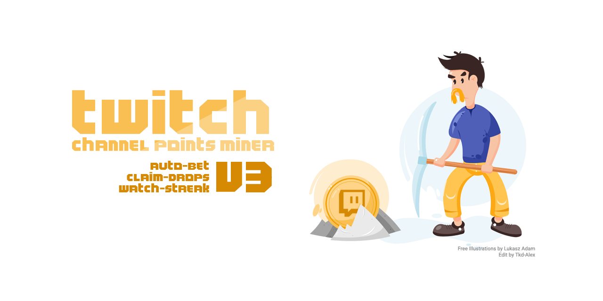

<p align="center">
<a href="https://github.com/zarmstrong/Twitch-Channel-Points-Miner-v3/releases"></a>
<a href="https://github.com/zarmstrong/Twitch-Channel-Points-Miner-v3/stargazers"></a>
<a href="https://github.com/zarmstrong/Twitch-Channel-Points-Miner-v3/blob/master/LICENSE"></a>
<a href="https://github.com/zarmstrong/Twitch-Channel-Points-Miner-v3"></a>
</p>

<p align="center">
<a href="https://hub.docker.com/r/zacharmstrong/twitch-channel-points-miner"></a>
<a href="https://hub.docker.com/r/zacharmstrong/twitch-channel-points-miner"></a>
<a href="https://hub.docker.com/r/zacharmstrong/twitch-channel-points-miner"></a>
<a href="https://hub.docker.com/r/zacharmstrong/twitch-channel-points-miner"></a>
<a href="https://hub.docker.com/r/zacharmstrong/twitch-channel-points-miner"></a>
</p>

<h1 align="center">https://github.com/zarmstrong/Twitch-Channel-Points-Miner-v3</h1>

**Credits**
- Main idea: https://github.com/gottagofaster236/Twitch-Channel-Points-Miner
- ~~Bet system (Selenium): https://github.com/ClementRoyer/TwitchAutoCollect-AutoBet~~
- Based on: https://github.com/Tkd-Alex/Twitch-Channel-Points-Miner-v2
- Previous maintainer: [Roman Davydov](https://github.com/rdavydov), whose [v2 fork](https://github.com/rdavydov/Twitch-Channel-Points-Miner-v2) this project builds upon

> A simple script that will watch a stream for you and earn the channel points.

> It can wait for a streamer to go live (+_450 points_ when the stream starts), it will automatically click the bonus button (_+50 points_), and it will follow raids (_+250 points_).

Read more about the channel points [here](https://help.twitch.tv/s/article/channel-points-guide).

# README Contents

- [Community](#community)
- [Features](#features)
- [How to use](#how-to-use)
  - [Install and start](#install-and-start)
  - [Configuration file](#configuration-file)
  - [Documentation](#documentation)
  - [Limits](#limits)
- [Disclaimer](#disclaimer)

## Community
If you want to help with this project, please leave a star 🌟 and share it with your friends! 😎

If you want to support development, you can donate through Ko-fi or cryptocurrency:

[](https://ko-fi.com/B0B61NBJ0)

| Currency | Wallet address |
| --- | --- |
| Bitcoin (BTC) | `bc1qdpg70u7u6fganwtddf9z3uwugkxkpltre4cva3` |
| Ethereum (ETH) | `0x926fce1Eb65e867Af751a9cB75394DF001b58DF0` |
| Dogecoin (DOGE) | `DHo26McxeVLFwQmRXdUH7LyHsdEUoVFvga` |

If you have any issues or you want to contribute, you are welcome! But please read the [CONTRIBUTING.md](https://github.com/zarmstrong/Twitch-Channel-Points-Miner-v3/blob/master/CONTRIBUTING.md) file. Contributors working on code can find setup, test commands, and suite conventions in the [testing guide](tests/README.md).

## Features

- Automatically watches eligible channels and claims channel-point bonuses.
- Waits for configured streamers to go live and follows eligible raids.
- Prioritizes channels by watch streaks, Drops, subscriptions, configured order,
  or channel-point balance.
- Discovers live channels from configured game categories and active Drop
  campaigns.
- Tracks Drop progress and claims available Drop rewards and Moments.
- Participates in channel-point predictions with configurable strategies,
  spending limits, filters, and timing.
- Supports per-streamer settings, follower imports, and blacklists.
- Can join IRC chat and notify you when your username is mentioned.
- Sends selected events through Telegram, Discord, Matrix, Pushover, Gotify,
  email, or a generic webhook.
- Provides colorized console logs, rotating log files, compact logging, and a
  graceful-shutdown report.
- Includes an optional analytics server for point history, Drops, and log viewing.
- Supports persistent Docker configuration with automatic legacy-runner
  conversion and limited live configuration reloads.

## How to use

Choose one of the three supported paths below. Each quick start takes you from
installation through the first launch without requiring another section.

### Install and start

#### Docker quick start

Docker is the best fit for servers, NAS devices, and unattended operation.
Choose either Docker Compose or the plain Docker CLI. Both examples persist the
configuration, authentication cookies, logs, and analytics in the current
directory.

##### Docker Compose

Create an empty working directory containing this `compose.yml`:

```yaml
services:
  miner:
    image: zacharmstrong/twitch-channel-points-miner:latest
    restart: "no"
    stop_grace_period: 60s
    stdin_open: true
    tty: true
    environment:
      - TERM=xterm-256color
      - TZ=America/Denver
    volumes:
      - ./analytics:/usr/src/app/analytics
      - ./cookies:/usr/src/app/cookies
      - ./logs:/usr/src/app/logs
      - ./config:/usr/src/app/config
    ports:
      - "54455:54455"
```

Run `docker compose up`. On the first run, the container creates
`config/config.py` and exits. Edit that file, replace the example account and
streamers, disable unused notification providers, and change `restart: "no"` to
`restart: unless-stopped`. Run `docker compose up` interactively to complete the
first Twitch sign-in, then use `docker compose up -d` for later starts.

##### Docker CLI

Create the persistent directories, then run a temporary container once to seed
the configuration:

```sh
mkdir -p analytics cookies logs config
docker run --rm -it \
    -e TERM=xterm-256color \
    -e TZ=America/Denver \
    -v "$(pwd)/analytics:/usr/src/app/analytics" \
    -v "$(pwd)/cookies:/usr/src/app/cookies" \
    -v "$(pwd)/logs:/usr/src/app/logs" \
    -v "$(pwd)/config:/usr/src/app/config" \
    -p 54455:54455 \
    zacharmstrong/twitch-channel-points-miner:latest
```

The container creates `config/config.py` and exits. Edit that file, replace the
example account and streamers, and disable unused notification providers. Then
create the persistent miner container and complete Twitch authentication in its
interactive terminal:

```sh
docker run --name twitch-miner -it \
    --restart unless-stopped \
    --stop-timeout 60 \
    -e TERM=xterm-256color \
    -e TZ=America/Denver \
    -v "$(pwd)/analytics:/usr/src/app/analytics" \
    -v "$(pwd)/cookies:/usr/src/app/cookies" \
    -v "$(pwd)/logs:/usr/src/app/logs" \
    -v "$(pwd)/config:/usr/src/app/config" \
    -p 54455:54455 \
    zacharmstrong/twitch-channel-points-miner:latest
```

After the initial login, manage the existing container with
`docker stop twitch-miner` and `docker start twitch-miner`; do not run the
creation command again. On Windows, replace each `$(pwd)` expression with an
absolute host path, such as `C:\TwitchMiner\config`.

The later [Docker reference](docs/docker.md#docker) covers multiple accounts, Portainer, time
zones, and graceful shutdown behavior in more detail.

#### Windows quick start

The Windows executable does not require Python or Git. Two distributions are
published on every release: `TwitchChannelPointsMiner-<version>-Setup.exe`
(installer, recommended) and `TwitchChannelPointsMiner-Portable-<version>.zip`
(portable, no installation). They differ only in where configuration, login
cookies, analytics, and logs are stored - the installer keeps them in your
Windows user profile, separate from the program itself, while the portable
build keeps everything beside the executable so the whole thing can be moved
or run from removable media. See [Windows](docs/windows.md#windows) for the full comparison.

1. Download `TwitchChannelPointsMiner-<version>-Setup.exe` from the official
   [Releases page](https://github.com/zarmstrong/Twitch-Channel-Points-Miner-v3/releases)
   and run it. The steps below describe the installer; see
   [Windows](docs/windows.md#windows) for the portable ZIP instead.
2. Let the installer finish and launch the app. It creates a configuration
   file and opens a desktop window directly on the **Config** tab.
3. Fill in your Twitch username and the channels to watch, or edit the
   configuration file directly as described below.
4. Follow the Twitch sign-in instructions shown in the window's Console tab.

The later [Windows reference](docs/windows.md#windows) covers both distributions, updates,
and troubleshooting in detail.

#### Source checkout quick start

Use a source checkout when you want to inspect, develop, or modify the project.
Python 3.11 through 3.14 is supported.

```sh
git clone https://github.com/zarmstrong/Twitch-Channel-Points-Miner-v3
cd Twitch-Channel-Points-Miner-v3
python3 -m venv venv
source venv/bin/activate  # Windows PowerShell: .\venv\Scripts\Activate.ps1
pip install -r requirements.txt
mkdir -p config
cp config.example.py config/config.py
```

To use the optional [Apprise](docs/notifications.md#apprise) notifier, also run
`pip install -r requirements-optional.txt`.

Edit `config/config.py`, then start the stable runner:

```sh
python -m TwitchChannelPointsMiner.runner --config-dir ./config
```

For every method, keep the populated configuration private: never commit or
share account names, passwords, webhook URLs, or notification credentials.
Portainer is a Docker deployment. The [Termux](docs/other-platforms.md#termux) instructions are
outdated and unsupported, and there is no maintained [Replit](docs/other-platforms.md#replit)
deployment.

### Configuration file

All run methods use `config/config.py`. Docker and source-checkout users edit the
file created or copied during their quick start; the Windows executable creates
the same file beside the executable.

A minimal configuration looks like this:

```python
from TwitchChannelPointsMiner.classes.Settings import FollowersOrder

MINER_CONFIG = {
    "username": "your-twitch-username",
    "enable_analytics": False,
}

STREAMERS = ["streamer1", "streamer2"]

MINE_CONFIG = {
    "followers": False,
    "followers_order": FollowersOrder.ASC,
    "blacklist": [],
    "categories": [],
}

# Set to a dictionary to start the analytics server, or leave as None.
ANALYTICS_CONFIG = None
```

The file is normal Python, so import any enums or settings classes used by its
values. See [config.example.py](config.example.py) for the complete annotated
configuration, including logger integrations, per-streamer settings, predictions,
categories, and analytics.

### Documentation

| Guide | Covers |
| :-- | :-- |
| [Configuration](docs/configuration.md) | `MINER_CONFIG`, `STREAMERS`, `MINE_CONFIG`, `ANALYTICS_CONFIG`, runner behavior and live reloads |
| [Category-based Drops](docs/categories-and-drops.md) | Category discovery, campaign filtering, wildcard fallback, examples and troubleshooting |
| [Settings](docs/settings.md) | Android login, `LoggerSettings`, color palette, `StreamerSettings` |
| [Notifications](docs/notifications.md) | Telegram, Discord, webhook, ntfy, Apprise, Matrix, Pushover, Gotify, email, events |
| [Predictions](docs/predictions.md) | `BetSettings`, bet strategies, `FilterCondition`, `DelayMode` |
| [Analytics](docs/analytics.md) | The analytics server, HTTPS reverse proxy, analytics storage |
| [Logs](docs/logs.md) | Full and compact log formats, the graceful-shutdown report |
| [Docker](docs/docker.md) | Docker Hub images, graceful shutdowns, Portainer |
| [Windows](docs/windows.md) | Standard and portable builds, setup, updates, troubleshooting |
| [Other platforms](docs/other-platforms.md) | Termux on Android, Replit |
| [Migration](docs/migration.md) | Migrating from `run.py`, persisted data versions, legacy cookies |

### Limits
_**Twitch has a limit - you can't watch more than two channels at one time. Set
`streams_watched` to `1` or `2` in `MINER_CONFIG` to control how many are watched
concurrently; the default is `2`. The highest-priority streamers are selected.**_

The `streams_watched` option exists because each mined channel creates viewing
activity on the account. Twitch Turbo users have reported that running two mined
streams continuously, especially while also watching Twitch normally, may result
in ads being served ([upstream issue #787](https://github.com/rdavydov/Twitch-Channel-Points-Miner-v2/issues/787)).
Setting the option to `1` reduces the miner's concurrent viewing activity. It is
a mitigation rather than a guarantee, because Twitch does not document this
behavior.

Make sure to write the streamers array in order of priority from left to right. If you use `followers=True` you can choose to download the followers sorted by follow date (ASC or DESC).

Since October 2026 Twitch only credits time-based Drop progress while a
stream's media segments are actually being requested, so the miner polls the
HLS playlist of each watched stream that has Drops to earn and sends a
lightweight `HEAD` request for every new segment. No stream audio or video is
downloaded, and streams watched only for channel points are skipped. This runs
automatically in the background and needs no configuration.

## Disclaimer
This project comes with no guarantee or warranty. You are responsible for whatever happens from using this project. It is possible to get soft or hard banned by using this project if you are not careful. This is a personal project and is in no way affiliated with Twitch.
